# What does a vortex-generator retrofit cost the drivetrain? Fleet evidence for the load price of an energy gain at an operating wind farm

Yi Wang^a,*^, Yongqing Tang^b^

^a^ College of Engineering, Lishui University, Lishui, Zhejiang 323000, China
^b^ School of Physics, Mechanics and Electronics, Longyan University, Longyan, Fujian, China
\* Corresponding author: jefflsxy@lsu.edu.cn

> DRAFT v2 (2026-11-01). Items in {{braces}} still need author input or a final check.

## Highlights
- Fleet SCADA prices the drivetrain load cost of a vortex-generator retrofit
- 4.8% more energy came with 2.3% more main-shaft torque fatigue load
- Each 1% of extra energy cost about 0.5% of extra torque DEL (m = 3)
- The cost is 60% of naive scaling: rotor speed rose and gains were part-load
- Placebo turbines, known-truth injection and a 20-turbine rollout check it

## Abstract
Aerodynamic retrofits such as vortex generators are validated by the energy they add, but the extra load they pass to the drivetrain is rarely measured. We use the open SCADA data of the Hill of Towie wind farm (21 Siemens SWT-2.3-VS-82 turbines), where one turbine received a vortex-generator retrofit in September 2021 while the other 20 remained unmodified for nine months, as a natural experiment. A reference-cell estimator built from the neighbouring turbines, corrected for the null drift observed on the 20 unmodified turbines and checked by injecting a known effect into real data, attributes to the retrofit a 4.8% (95% CI 3.3–6.3%) energy gain, consistent with the operator's independent 4.3%, a 1.7 percentage-point increase in time at rated power, and a 2.3% (1.3–3.2%) increase in a quasi-static main-shaft torque damage-equivalent load (DEL) for an S-N exponent of 3. The retrofitted turbine ranks first of 21 on every outcome. Each 1% of additional energy therefore cost about 0.48% (0.39–0.54) of additional torque DEL, falling to 0.20 for an exponent of 10. This load cost ratio is about 60% of the value implied by scaling power at constant rotor speed, because the variable-speed controller passed one third of the gain into rotor speed (+1.7%) and because the gain arose mainly at part load. The 2022–23 rollout to the remaining 20 turbines reproduces the time-at-rated increase and a consistent load cost ratio. The ratio can be estimated from routine SCADA data alongside standard upgrade validation and belongs in retrofit decisions for ageing drivetrains.

## Keywords
Wind turbine retrofit; vortex generators; drivetrain fatigue; damage-equivalent load; SCADA; natural experiment

## 1. Introduction

Retrofitting operating wind turbines with aerodynamic add-ons is now a routine way to raise output from existing assets. Vortex generators (VGs) delay separation on the thick inboard airfoils, raise lift near stall and are typically sold on an annual energy production (AEP) uplift of a few percent [1,2]. Field verification of such upgrades has matured into a small methods literature: post-upgrade production is compared with a model of what the turbine would have produced without the upgrade, built from nearby reference turbines or pre-upgrade behaviour [3–6]. Reported VG uplifts range from about 2% to 6% [3,7,8], and the operator of the Hill of Towie wind farm in Scotland has published an open-source, IEC 61400-12-1-style [9] validation of its own "AeroUp" VG retrofit at +4.3% (90% CI 3.3–5.3%) for the first retrofitted turbine [10].

The other side of the ledger has received far less attention. More energy captured below rated power means more aerodynamic torque passed through the main shaft, gearbox and generator for a larger share of the time. The drivetrain, and the gearbox in particular, already dominates downtime per failure in field reliability surveys [11–14]. Upgrade studies acknowledge that a retrofit may affect the residual lifetime of the turbine [4], yet none quantifies it. Load effects of VGs are known mainly from aeroelastic simulation, which reports blade-root flapwise damage-equivalent loads (DELs) rising by 4–7% when VGs are added to contaminated blades [15], and from one instrumented research turbine, where VGs on clean blades increased flapwise blade moments [16]. Multi-criteria retrofit evaluation frameworks call for load metrics but have so far been illustrated with assumed numbers [17]. To our knowledge no study has measured, on commercial turbines, how much additional drivetrain load exposure an aerodynamic retrofit buys per unit of energy gained.

That ratio is what an owner needs. A retrofit decision trades a known revenue gain against a drivetrain whose remaining life is uncertain; a turbine running beyond its design life, or with a gearbox of known weakness, may not be able to afford a retrofit that a younger machine could. We therefore define a load cost ratio,

C = ΔDEL / ΔE,                                                    (1)

the relative change in a drivetrain torque damage-equivalent load per relative change in energy, and estimate it from routine 10-minute SCADA data.

The Hill of Towie open dataset [18] makes this possible. Its 21 identical Siemens SWT-2.3-VS-82 turbines were retrofitted in two stages: one turbine (T13) in September 2021, the remaining 20 between July 2022 and May 2023. The first stage is a clean natural experiment: for nine and a half months, one turbine carried the upgrade while 20 sister turbines in the same wind field did not. The second stage provides an out-of-sample replication on 20 further turbines, although with a weaker design because no unmodified reference turbines remain.

This paper makes three contributions. (i) We estimate the change in time at rated power, energy and a main-shaft torque DEL proxy caused by the VG retrofit, with an estimator whose bias is checked by injecting a known effect into real data and whose null drift is measured on 20 placebo turbines. (ii) We report the load cost ratio C and show where in the operating envelope the energy gain and the load cost arise. (iii) We compare the measured C with the value implied by a pure scaling of power, which separates what is specific to the retrofit from what follows mechanically from the power-curve change. All analysis steps were specified before the data were examined, in a frozen plan with five pre-registered kill tests; two deviations forced by the data are reported as such (Section 3.6).

## 2. Data

### 2.1 Site and turbines
Hill of Towie is an onshore wind farm in Moray, Scotland, owned by TRIG and operated by RES. It comprises 21 Siemens SWT-2.3-VS-82 turbines (rated power 2300 kW, rotor diameter 82 m, geared drivetrain, variable speed, pitch regulated). The turbines entered commercial operation in May 2012, so they were about 9.4 years old when the first retrofit was installed. The operator released 10-minute SCADA data from 2016 onward, alarm logs, a shutdown-duration table and the AeroUp installation dates under a CC BY 4.0 licence [18]. We use the yearly archives for 2020–2023.

### 2.2 The retrofit
AeroUp is a vortex-generator retrofit [10]. T13 was retrofitted on 23–29 September 2021. Works on the other 20 turbines started between 14 July and 20 September 2022; twelve were completed within weeks, eight (T06, T07, T10, T11, T12, T15, T16, T20) only in April–May 2023 (Table 1). A separate control upgrade (TuneUp) was installed on nine turbines in March 2024, outside our analysis windows.

### 2.3 Variables
From tables tblSCTurGrid, tblSCTurbine and tblSCTurTemp we use the 10-minute mean active power P, main-shaft speed n, nacelle yaw position, the power reference set-point, the within-period standard deviation of active power, ambient temperature, and all bearing, gearbox-oil and generator temperature channels. Time stamps mark the end of each 10-minute period; the shutdown table, which marks the start, is shifted by 10 minutes before merging.

### 2.4 Normal-operation filter
A record is kept when the shutdown duration is zero, P > 0, the power set-point is ≥ 2290 kW (no curtailment), and main-shaft speed is above 0.3 rad/s. {{Data-quality table: share kept per turbine-year.}}

## 3. Methods

### 3.1 Outcomes
For each kept record we form the electrical torque proxy at the main shaft,

T = P / ω,  ω = 2πn/60,                                             (2)

which equals the aerodynamic torque minus drivetrain losses and inertial terms; at 10-minute resolution the inertial term averages out. Outcomes for a target turbine over a window are:
- E, the energy ratio change: ΣP_obs / ΣP_exp − 1;
- R, time at rated power: the share of records with P ≥ 0.95 × 2300 kW (in percentage points);
- D_m, the torque DEL proxy for S-N exponent m: (mean T_obs^m / mean T_exp^m)^{1/m} − 1, for m = 3 (welded and cast structures; also the conventional choice for shaft torque), 10/3 (roller bearings [19]), 4, 6, 8 and 10 (gear tooth bending and contact); 
- W, the relative change in mean rotor speed; SD, the relative change in mean within-10-minute power standard deviation; and temperature residuals for every bearing and gearbox channel.

D_m is a quasi-static load-level metric: it weights each 10-minute mean torque by its contribution to Miner damage under a power-law S-N curve, but it cannot see cycles inside the 10-minute period. Section 5.3 discusses what this misses.

### 3.2 Counterfactual from reference turbines
For each 10-minute stamp we form a farm reference state from all other turbines that are operating normally (at least 10 needed): their mean power, binned in 50 kW steps, and their circular-mean yaw, binned in eight 45° sectors. A target turbine's expected outcome in a post-retrofit record is the mean of its own pre-retrofit records in the same cell (Fig. 1b). Effects are observed minus expected, averaged over post records. This "reference-cell" estimator is a discretised version of the side-by-side methods used in upgrade validation [3,10]; it needs no anemometer and no power-curve model, and it treats any change in the target turbine's behaviour relative to its neighbours as the effect. Coverage of post records by pre cells was ≥ {{99.7}}%.

### 3.3 Drift correction and inference (T13 window)
Pre window: 1 January 2020 – 22 September 2021; post window: 30 September 2021 – 13 July 2022. T13 is excluded from every reference set. Each of the 20 unmodified turbines is run through the same estimator with the real dates; because nothing changed on them, their effects measure the estimator's null drift over the same calendar windows (seasonal mix, ageing, wake changes). The drift-corrected T13 effect is the T13 effect minus the median of the 20 placebo effects. Uncertainty in T13's own estimate comes from a weekly block bootstrap (2000 draws) of pre and post weeks; the placebo median is held fixed. Inference on whether T13 changed at all uses its rank among the 21 turbines (one-sided permutation p = rank/21).

### 3.4 Known-truth check
To test whether the estimator recovers an effect of the right size, we inject a known retrofit into each of the 20 unmodified turbines: post-window power is multiplied by 1.04 and capped at 2300 kW, torque is scaled by the same factor at the measured speed, and the estimator (with the drift correction from the other 19 turbines) is re-run. The injected truth is computed directly from the altered data.

### 3.5 Pure-scaling benchmark for C
If a retrofit simply multiplied power by a constant k below the rated cap, at unchanged rotor speed, the load cost ratio would follow from the turbine's own power distribution. We compute this benchmark C_scale(m) on T13's pre-retrofit records for k between 1.01 and 1.08 and compare it with the measured C at the k matching T13's measured E.

### 3.6 Replication on the 2022–23 rollout (deviation D1) and its null check (deviation D2)
The frozen plan specified a replication using turbines not yet retrofitted as references. The installation file showed that works on all 20 turbines started within ten weeks and eight finished only in 2023, so no such reference set exists (deviation D1, recorded before the replication was run). We instead used T13, whose state was constant after 2021, as the single reference turbine: cells are T13 power (50 kW) × T13 yaw (8 sectors); pre = 1 October 2021 – 13 July 2022 (only T13 retrofitted), post = June, July and October–December 2023 (all retrofitted; August–September dropped because the pre window lacks them); pre records are re-weighted to the post month mix. The pooled effect is the mean over turbines with a turbine-level bootstrap CI.
Because a single reference turbine is noisier and the windows are a year apart, we added a known-null check after the replication had been run (deviation D2): the identical estimator applied to 2020 versus 2021 (same months, no turbine changed state; T13 excluded), with T01 and, separately, T21 as reference. Its pooled effects measure the design's year-on-year drift. The gate for this check was written before it was run.

### 3.7 Sensitivity analyses
One factor at a time from the default: power-bin width (25, 100 kW), yaw sectors (4, 12), minimum number of reference turbines (8, 15), rated threshold (0.90, 0.98 × rated), month-of-year re-weighting of the pre window, dropping the first month after the retrofit, and starting the pre window in October 2020. We also replace the placebo median by the mean and by a trimmed mean. Finally, we replace the reference-power cells by cells of reference-turbine mean nacelle wind speed (0.5 m/s × eight yaw sectors), and decompose the effect by 1 m/s wind-speed bins on the reference wind speed and on T13's own anemometer (descriptive, added after the kill tests).

### 3.8 Pre-registration and code
The baseline estimator and five kill tests (K1 known truth, K2 drift-corrected T13 effect with rank test, K3 replication, K4 seasonal re-weighting, K5 within-10-minute variability) were frozen with SHA-256 hashes before any data were analysed; all five passed. The paper analyses in Sections 3.5 and 3.7, the power-bin decomposition and the event study are descriptive extensions added after the kill tests and are labelled as such. Code: {{GitHub/Zenodo DOI}}.

## 4. Results

### 4.1 Data
After filtering, 3,069,135 turbine-records of normal operation remain from 4,338,962 merged records for 2020–2023 (median 158,635 per turbine). In the T13 window the pre and post periods contain about 71,800 and 33,400 T13 records; 99.95% of post records fall in a cell populated before the retrofit.

### 4.2 The retrofit raised energy, time at rated power and torque exposure on T13
Relative to its own pre-retrofit behaviour in the same farm state, T13 produced 3.6% more energy after the retrofit, spent 1.35 percentage points (pp) more time at rated power, and its torque DEL proxy (m = 3) rose by 1.75% (raw estimates). Over the same calendar windows the 20 unmodified turbines drifted in the opposite direction: 17 of 20 show negative energy changes (median −1.2%), and 18 of 20 show negative time-at-rated changes (Fig. 2). Subtracting the placebo median, the drift-corrected effects on T13 are:

- energy +4.8% (95% CI 3.3–6.3%), consistent with the operator's independent +4.3% (90% CI 3.3–5.3%) [10];
- time at rated power +1.67 pp (0.46–2.81);
- torque DEL proxy +2.3% for m = 3 (1.3–3.2%), +2.2% for m = 10/3 and +1.0% for m = 10 (Table 2).

T13 ranks first of the 21 turbines on every one of these outcomes (one-sided permutation p = 0.048 for each).

T13's month-by-month deviation from the fleet has a seasonal pattern of its own (Fig. S4): before the retrofit it ran a few percent below its average in summer and above it in winter. To remove this, Fig. 3 compares each month with the same calendar month one year earlier and subtracts the fleet median of the same difference. In the eight complete pre-retrofit months of 2021 this year-on-year contrast averages −0.7% for energy, −0.42 pp for time at rated and −0.02% for torque DEL, with signs scattered around zero. In all nine post-retrofit months it is positive for energy and torque DEL, averaging +4.1%, +1.59 pp and +2.2% respectively, which reproduces the window estimate and gives C = 0.54. The single-month noise is large (pre-retrofit months range from −5% to +6% in energy), so the evidence lies in the consistent sign after the retrofit rather than in any one month. Re-weighting the pre window to the post-window month mix changes the window estimate only slightly (energy +4.7%, time at rated +1.42 pp, C = 0.50; Fig. S2).

The estimator recovers known effects. When +4% power (capped at rated) was injected into each unmodified turbine, the median recovered energy change was 3.29% against a true 3.37%, time at rated 2.40 pp against 2.58 pp, and torque DEL 2.71% against 2.93% (Fig. S3). The estimator therefore slightly under-recovers load changes, and the load cost ratio by about 8% (0.80 recovered against 0.87 true). All headline estimates are stable across twelve alternative specifications: energy 4.4–5.4%, time at rated 1.4–2.1 pp, C(m=3) 0.47–0.52, with T13 ranked first in every case (Fig. S2). Using the placebo mean or trimmed mean instead of the median changes C from 0.48 to 0.50. Defining farm-state cells by reference wind speed instead of reference power gives energy +4.7% (3.0–6.3%), time at rated +1.71 pp (0.45–2.95), torque DEL +2.4% (1.3–3.3%) and C = 0.50 (0.41–0.58), again with T13 ranked first among 21 turbines on all three outcomes.

### 4.3 Load cost ratio
Each 1% of additional energy cost 0.48% (95% CI 0.39–0.54) of additional main-shaft torque DEL at m = 3 (Fig. 5). The ratio falls with the S-N exponent: 0.45 at m = 10/3 (rolling bearings), 0.40 at m = 4, 0.31 at m = 6 and 0.20 at m = 10. Because Miner damage scales as DEL^m, the corresponding increase in quasi-static fatigue damage per unit time is about 7% for m = 3 and 7.3% for m = 10/3, or roughly 1.5% damage per 1% energy.

The measured ratio is well below what a naïve "more power, same machine" view implies. If the retrofit had multiplied T13's power by a constant factor below the rated cap at unchanged rotor speed, a 3.6–4.3% energy gain would carry C(m=3) ≈ 0.78–0.79, and C(m=10) ≈ 0.48–0.50 (Fig. 5, grey). The measured C is about 60% of that benchmark at every exponent.

### 4.4 Where the gain and the cost arise
The energy gain is a part-load phenomenon (Fig. 4a). Farm states with reference power between 200 and 1000 kW contribute 65% of T13's energy gain, and states above 1600 kW contribute almost nothing. The torque-cubed gain is shifted to higher power: bins from 600 to 1600 kW each contribute 14–16% of it (Fig. 4b), because torque cubed weights higher loads more. Time at rated power rises because the turbine reaches rated in slightly lower winds, not because it delivers more at rated.

Two operating variables move with the energy gain. Mean rotor speed rose by 1.66% (1.15–2.14%; rank 2 of 21) and the mean blade-pitch reference by 0.21° (0.08–0.34°; rank 1). The within-10-minute power standard deviation did not change detectably (+1.1%, −3.1 to +5.7%; rank 3), consistent with the frozen kill test K5.

### 4.5 Thermal side evidence
Temperatures give only weak support. Compared within the same power and ambient-temperature cells, the gearbox high-speed bearing (generator side) warmed by 0.29 K, the largest change among the 21 turbines (rank 1), and the main bearing by 0.47 K (rank 4). Gearbox oil (−0.06 K, rank 15), the intermediate- and high-speed rotor-side bearings and the generator windings show no distinctive change (ranks 3–15). Of 30 temperature channels, T13 ranks first only on the high-speed bearing; at the turbine-level resolution of a 21-turbine rank test this is what chance alone would produce about once in 21 channels, so we treat the thermal evidence as consistent with, not as confirmation of, a higher drivetrain load.

### 4.6 Replication on the 2022–23 rollout
With T13 as the only reference turbine, the 20 later-retrofitted turbines show pooled changes of +5.2% energy (3.2–7.5%), +1.82 pp time at rated (1.50–2.14; 19 of 20 positive) and +2.8% torque DEL (2.0–3.7%), giving C = 0.54 (0.31–0.85) (Fig. 6). The known-null check of this design (2020 vs 2021, no turbine changed) is not null for energy and load: +1.0% energy and +1.05% DEL with T01 as reference, +2.3% and +1.35% with T21. Time at rated is close to null (+0.33 and +0.05 pp). Subtracting the null drift gives rollout effects of about +2.9–4.2% energy, +1.5–1.8% DEL and +1.5–1.8 pp time at rated, and C ≈ 0.42–0.50. The replication therefore confirms the direction and size of the time-at-rated effect and is consistent with the T13 load cost ratio, but its energy and load magnitudes depend on a drift correction that we can only bracket.

## 5. Discussion

### 5.1 Why the load price is low: the control law and where the gain lands
Two mechanisms account for C being about 0.6 of the naïve benchmark, and both are visible in the data.

First, the controller. Below rated speed, a variable-speed turbine tracks its optimal tip-speed ratio with a generator torque law of the form T = Kω², so that P = Kω³. An aerodynamic gain that is absorbed by this law raises rotor speed and torque together: to first order, ΔT/T = (2/3)ΔP/P and Δω/ω = (1/3)ΔP/P. The measured rotor-speed increase, +1.66%, is almost exactly one third of the measured energy gain of 4.8%. Part of the extra power thus leaves the drivetrain as speed rather than torque, and in the speed-tracking region the torque elasticity is 2/3 rather than 1.

Second, the location of the gain. Vortex generators act on the thick inboard sections, where they delay stall at the angles of attack typical of moderate winds [1,8]. At Hill of Towie almost all of the energy gain arises below about 1400 kW, where torque is far below its rated value and contributes little to a DEL that weights loads by T^m. The steeper the S-N curve, the stronger this dilution, which is why C falls from 0.48 at m = 3 to 0.20 at m = 10. A retrofit whose gain landed near rated power (for example a power boost or a control-based uprating) would have a much higher load price per unit energy.

An independent analysis of the same farm places most of the gain at wind speeds of 10–18 m/s [20], which for this turbine lies near and above rated. We traced the difference to the wind-speed variable used for binning (Fig. S5). When we bin our per-record effects on the mean nacelle wind speed of the reference turbines, which the retrofit cannot affect, 85% of T13's net energy gain falls below 10 m/s, 15% at 10–13 m/s and almost none above 13 m/s; the relative uplift peaks at +9–11% at 5–8 m/s and fades to zero as the fleet power curve approaches rated (about 2020 kW at 12 m/s and 2290 kW at 17 m/s on this axis). This agrees with the power-bin decomposition. When we bin the same records on T13's own nacelle anemometer, as is usual in single-turbine power-curve analysis, 71% of the gain moves to 10–18 m/s and the uplift turns negative below 6 m/s (−11% to −19% at 3–5 m/s). A vortex-generator retrofit that lowers output at low wind is not plausible, and for the same expected power T13's anemometer reads about 3 m/s higher than the reference wind speed. We therefore read the 10–18 m/s concentration as a property of the target's own anemometer axis, which is offset from the farm wind and sits on the rotor whose flow the retrofit changes, rather than as a disagreement about the size of the effect. Both analyses find a gain of about 4–5%. For load assessment the distinction matters: the farm-state axis places the gain where torque is low, which is why the load price is low.

### 5.2 What the number means for retrofit decisions
For an owner, C converts a validated energy uplift into a drivetrain exposure. At Hill of Towie a 4–5% energy gain bought roughly a 2% increase in the quasi-static torque DEL, or about 7% more fatigue damage per unit time for m = 3–10/3. Whether that matters depends on the remaining life budget. The Hill of Towie turbines were retrofitted at about ten years of age. For a drivetrain designed for 20 years that has consumed half of its damage budget, a 7% higher damage rate shortens its remaining life by about 0.65 years in a pure Miner sense, while the energy gain accrues every year. The asymmetry is large enough that the retrofit is likely net positive here, but C is the number that needs to be checked for turbines with known gearbox weakness or with life-extension cases, and it should be estimated with the same data that already validate the energy gain.

The method requires nothing beyond standard 10-minute SCADA from the retrofitted turbine and its neighbours, so it can be added to any side-by-side upgrade validation of the kind already practised [3,10] at no extra cost.

### 5.3 Limitations
- **Quasi-static load proxy.** T = P/ω is an electrical torque estimate averaged over 10 minutes. It captures the load level that drives low-frequency damage but not the cycles inside each 10-minute period, which drive much of the gear-tooth and bearing damage. The within-period power standard deviation did not change detectably, which argues against a large hidden change in fluctuation amplitude, but it is not a substitute for strain-gauge or high-rate torque data. C should be read as the price in load level, not in total fatigue damage.
- **Drivetrain only.** Blade-root and tower loads, the components on which VG studies have reported load increases [15,16], are not observable in SCADA data.
- **One clean retrofit.** The T13 estimate rests on a single turbine. Its rank of 1 in 21 gives p = 0.048 per outcome, which is the smallest p-value a 21-turbine permutation can produce. The 2022–23 replication supports the direction, but its single-reference design carries a year-on-year drift of 1–2% in energy and about 1.2% in DEL that we can only bracket (deviations D1 and D2).
- **Drift of the reference fleet.** The 20 placebo turbines drifted by a median −1.2% in energy over the T13 window. The correction is robust to the choice of median, mean or trimmed mean, but the cause of the drift (seasonal mix, wake changes, ageing) is not identified.
- **Slight under-recovery.** The known-truth test shows C under-recovered by about 8%; a bias-adjusted C(m=3) would be about 0.52.
- **Pitch.** The pitch-reference increase of 0.21° is small and its mechanism (earlier transition to pitch control, or a controller setting changed with the retrofit) cannot be separated with these data.
- **Seasonal heterogeneity of T13.** T13 deviates from the fleet seasonally (Fig. S4). The window estimate, the month-re-weighted estimate and the same-month year-on-year contrast agree (energy 4.1–4.8%, C 0.48–0.54), but a seasonally varying retrofit effect (for example through air density or turbulence) cannot be excluded with one turbine-year of post data.

## 6. Conclusions
- A vortex-generator retrofit at an operating wind farm raised energy by 4.8% (95% CI 3.3–6.3%) and time at rated power by 1.7 pp on the first retrofitted turbine, measured against 20 unmodified neighbours.
- Each 1% of extra energy cost about 0.5% of extra main-shaft torque damage-equivalent load at m = 3, and less for steeper S-N curves (0.2 at m = 10).
- This load price is about 60% of what a pure power scaling would imply, because the variable-speed controller passes a third of the gain into rotor speed and because the gain arises at part load.
- The 2022–23 rollout on 20 further turbines reproduces the time-at-rated effect (+1.5 to +1.8 pp after drift correction) and a consistent load cost ratio.
- The load cost ratio can be estimated from routine SCADA data alongside standard energy-uplift validation and should be part of retrofit decisions for ageing drivetrains.

## Data and code availability
Data: Hill of Towie open dataset v2.1.0, Zenodo 10.5281/zenodo.22662930, CC BY 4.0. Code: frozen kill-test scripts with SHA-256 hashes and the paper analysis scripts are available at {{GitHub repository / Zenodo DOI}}.

## Declaration of generative AI use
{{Renewable Energy (Elsevier) policy: AI-assisted writing disclosed in a dedicated statement before the references. Draft: "During the preparation of this work the authors used Claude (Anthropic) to write analysis code and draft and edit the text. The authors reviewed and edited the content and take full responsibility for the content of the publication."}}

## Table 2 (draft). Drift-corrected effects on T13 (95% CI, weekly block bootstrap; rank of 21)
| Outcome | Estimate | 95% CI | Rank |
|---|---|---|---|
| Energy ratio change | +4.81% | 3.29 to 6.25% | 1 |
| Time at rated power | +1.67 pp | 0.46 to 2.81 | 1 |
| Torque DEL, m = 3 | +2.30% | 1.31 to 3.19% | 1 |
| Torque DEL, m = 10/3 | +2.15% | 1.20 to 3.00% | 1 |
| Torque DEL, m = 4 | +1.93% | 1.07 to 2.71% | 1 |
| Torque DEL, m = 6 | +1.48% | 0.79 to 2.09% | 1 |
| Torque DEL, m = 10 | +0.96% | 0.46 to 1.40% | 1 |
| Rotor speed | +1.66% | 1.15 to 2.14% | 2 |
| Pitch reference | +0.21° | 0.08 to 0.34° | 1 |
| Within-10-min power std | +1.1% | −3.1 to +5.7% | 3 |
| C (m = 3) | 0.48 | 0.39 to 0.54 | |
| C (m = 10/3) | 0.45 | 0.36 to 0.51 | |
| C (m = 10) | 0.20 | 0.13 to 0.25 | |

## Table 1. AeroUp installation dates (first and last day of works)
| Turbine | First | Last | | Turbine | First | Last |
|---|---|---|---|---|---|---|
| T01 | 2022-07-23 | 2022-08-01 | | T12 | 2022-09-01 | 2023-05-09 |
| T02 | 2022-07-18 | 2022-07-28 | | **T13** | **2021-09-23** | **2021-09-29** |
| T03 | 2022-07-28 | 2022-08-14 | | T14 | 2022-08-30 | 2022-10-03 |
| T04 | 2022-07-31 | 2022-09-10 | | T15 | 2022-07-14 | 2023-05-26 |
| T05 | 2022-07-16 | 2022-07-22 | | T16 | 2022-08-27 | 2023-04-15 |
| T06 | 2022-07-16 | 2023-04-15 | | T17 | 2022-08-10 | 2022-08-27 |
| T07 | 2022-09-20 | 2023-05-25 | | T18 | 2022-08-22 | 2022-09-21 |
| T08 | 2022-08-08 | 2022-09-21 | | T19 | 2022-08-11 | 2022-08-23 |
| T09 | 2022-09-13 | 2022-10-03 | | T20 | 2022-08-13 | 2023-04-20 |
| T10 | 2022-08-04 | 2023-04-26 | | T21 | 2022-08-21 | 2022-09-01 |
| T11 | 2022-09-09 | 2023-05-18 | | | | |

Source: Hill_of_Towie_AeroUp_install_dates.csv in the dataset.

## Figure captions
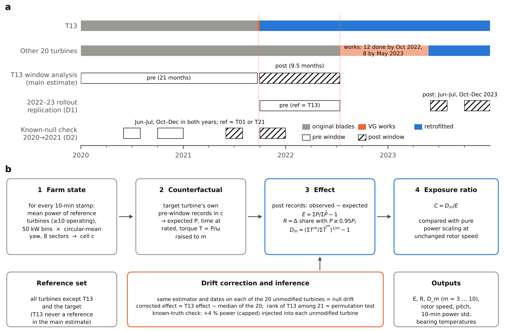
**Fig. 1.** Study design. (a) Retrofit timeline and analysis windows. T13 received vortex generators on 23–29 September 2021; the other 20 turbines were retrofitted between 14 July 2022 and 26 May 2023. Main estimate: T13 pre window 1 January 2020 – 22 September 2021, post window 30 September 2021 – 13 July 2022, with all 20 unmodified turbines as the reference fleet. Replication (deviation D1): the 20 later turbines, with T13 as the single reference, comparing October 2021 – July 2022 with June–July and October–December 2023. Known-null check (deviation D2): the same single-reference design applied to the same calendar months of 2020 and 2021, when no turbine changed. (b) Reference-cell estimator. Each 10-minute stamp is assigned to a farm-state cell (reference mean power × yaw sector); the target turbine's expected outcome is its own pre-window mean in that cell; effects compare observed and expected post-window records; the null drift is measured by running the identical estimator on each unmodified turbine.

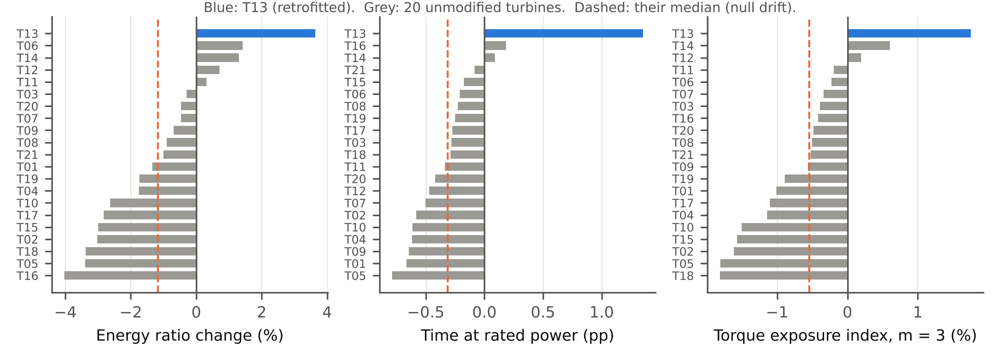
**Fig. 2.** Raw effects in the T13 window for all 21 turbines, each estimated against the same reference set (all turbines except T13 and the target). Blue: T13 (retrofitted). Grey: unmodified turbines, whose effects measure the null drift of the estimator; dashed line: their median, which is subtracted to obtain drift-corrected effects.

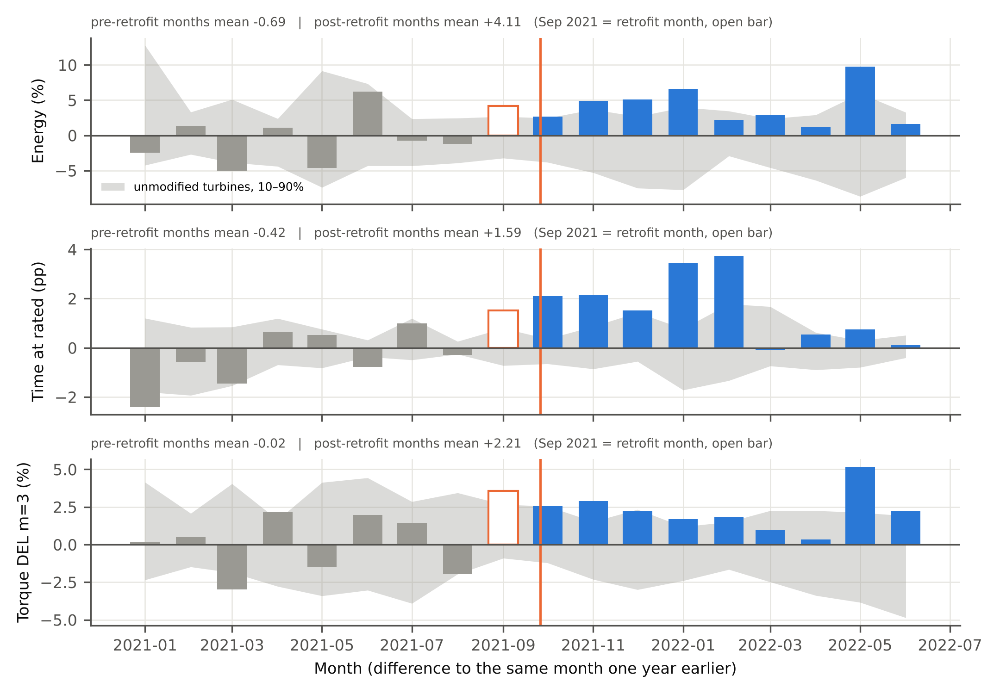
**Fig. 3.** Same-calendar-month year-on-year contrast. Each bar is T13's monthly effect minus its effect in the same month a year earlier, minus the fleet median of the same difference. Grey band: 10th–90th percentile of the unmodified turbines. Open bar: retrofit month (September 2021).

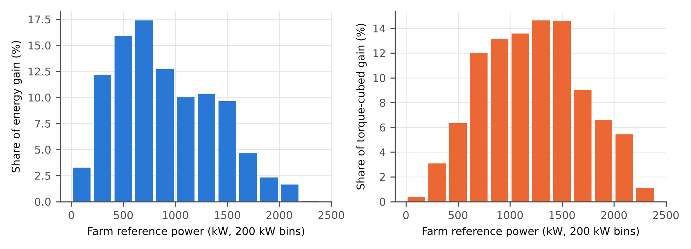
**Fig. 4.** Where the gain arises. Share of T13's energy gain (a) and of its torque-cubed gain (b) by farm reference power, after subtracting the median of the unmodified turbines.

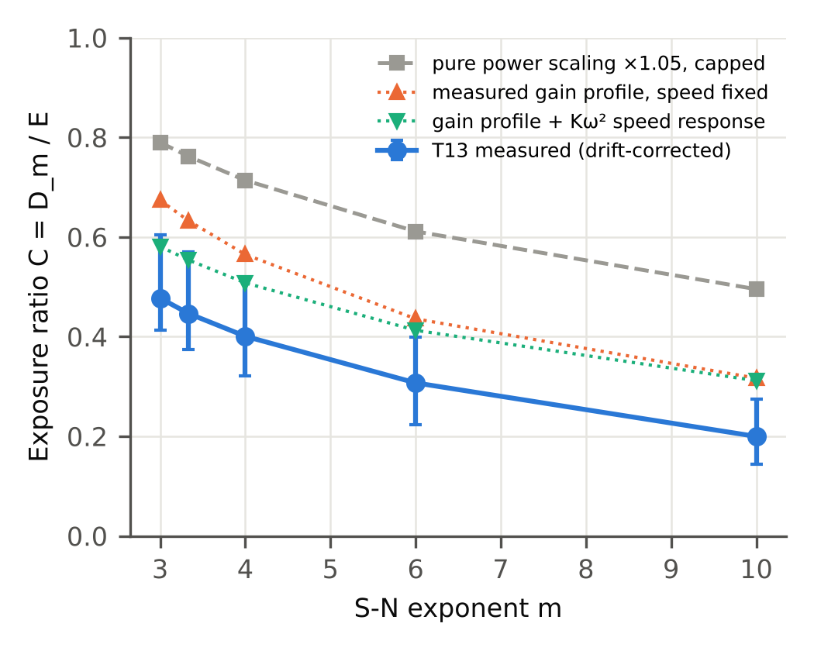
**Fig. 5.** Load cost ratio C = ΔDEL/ΔE against the S-N exponent m. Blue: T13, drift-corrected, with 95% weekly block bootstrap intervals. Grey: benchmark for a pure power scaling (×1.05, capped at rated, rotor speed unchanged) applied to T13's own pre-retrofit data.

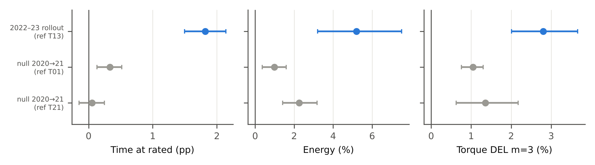
**Fig. 6.** Replication on the 2022–23 rollout with T13 as the single reference turbine (blue), and the known-null check of the same design on 2020 versus 2021 with T01 or T21 as reference (grey). Intervals: 95% turbine bootstrap.

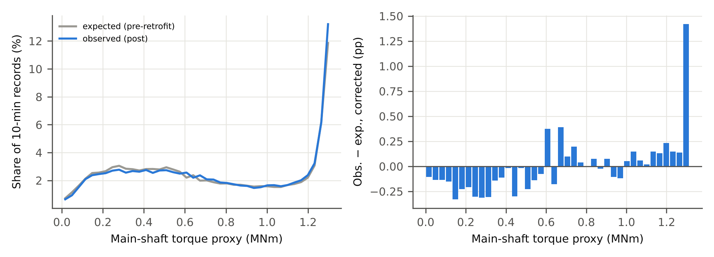
**Fig. S1.** T13 torque spectrum after the retrofit, observed versus expected from pre-retrofit cells (a), and the drift-corrected difference (b).

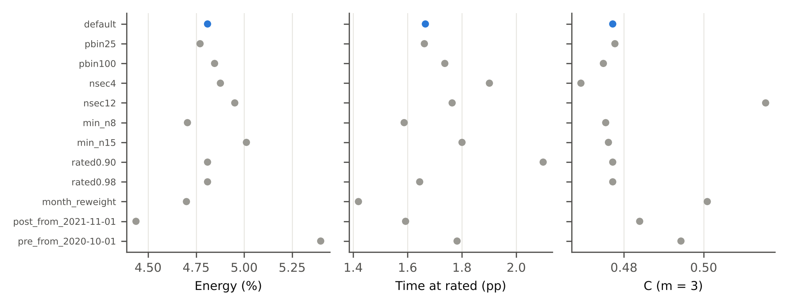
**Fig. S2.** Sensitivity of the drift-corrected T13 effects to one-at-a-time changes of the specification.

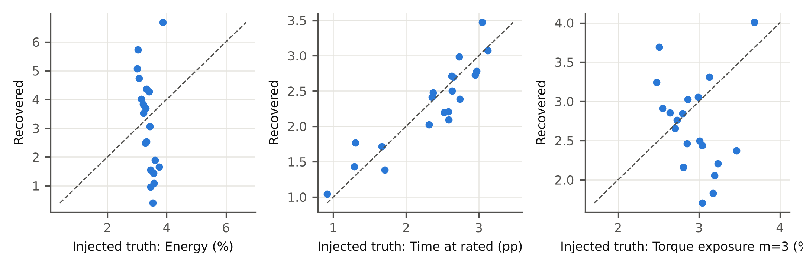
**Fig. S3.** Known-truth check: +4% power (capped) injected into each unmodified turbine; recovered versus injected values.

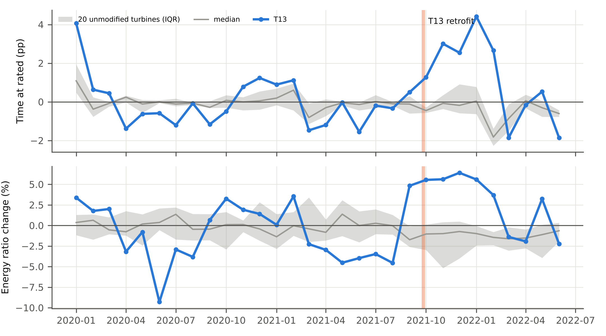
**Fig. S4.** Monthly effects relative to the pre-retrofit cells for T13 (blue) and the unmodified turbines (median and interquartile range). Pre-retrofit months are in-sample and show T13's own seasonal deviation from the fleet.

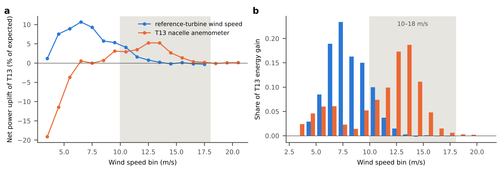
**Fig. S5.** T13's drift-corrected effect by 1 m/s wind-speed bin, binned on the mean nacelle wind speed of the reference turbines (blue) and on T13's own nacelle anemometer (orange). (a) Net power uplift relative to expected power; (b) share of T13's total net energy gain. Bins holding less than 0.5% of records are omitted. Shaded: 10–18 m/s, where [20] locates most of the gain.

## References

[1] Z. Zhao, R. Jiang, J. Feng, H. Liu, T. Wang, W. Shen, M. Chen, D. Wang, Y. Liu, Researches on vortex generators applied to wind turbines: a review, Ocean Eng. 253 (2022) 111266. https://doi.org/10.1016/j.oceaneng.2022.111266.

[2] H. Mueller-Vahl, G. Pechlivanoglou, C.N. Nayeri, C.O. Paschereit, Vortex generators for wind turbine blades: a combined wind tunnel and wind turbine parametric study, in: Proc. ASME Turbo Expo 2012: Turbine Technical Conference and Exposition, Vol. 6, Copenhagen, 2012, pp. 899–914. https://doi.org/10.1115/GT2012-69197.

[3] D. Astolfi, F. Castellani, L. Terzi, Wind turbine power curve upgrades, Energies 11 (2018) 1300. https://doi.org/10.3390/en11051300.

[4] D. Astolfi, F. Castellani, M.L. Fravolini, S. Cascianelli, L. Terzi, Precision computation of wind turbine power upgrades: an aerodynamic and control optimization test case, J. Energy Resour. Technol. 141 (2019) 051205. https://doi.org/10.1115/1.4042450.

[5] L. Terzi, A. Lombardi, F. Castellani, D. Astolfi, Innovative methods for wind turbine power curve upgrade assessment, J. Phys. Conf. Ser. 1102 (2018) 012036. https://doi.org/10.1088/1742-6596/1102/1/012036.

[6] F. Castellani, D. Astolfi, L. Terzi, Wind turbine power curve upgrades: methods for the assessment and test cases study, J. Phys. Conf. Ser. 1452 (2020) 012004. https://doi.org/10.1088/1742-6596/1452/1/012004.

[7] M. Manolesos, Y. Celik, H. Ramsay, R. Karande, B. Wood, I. Dinwoodie, I. Masters, M. Harrold, G. Papadakis, Performance improvement of a Vestas V52 850kW wind turbine by retrofitting passive flow control devices, J. Phys. Conf. Ser. 2767 (2024) 022027. https://doi.org/10.1088/1742-6596/2767/2/022027.

[8] H. Moon, J. Jeong, S. Park, K. Ha, J.-H. Jeong, Numerical and experimental validation of vortex generator effect on power performance improvement in MW-class wind turbine blade, Renew. Energy 212 (2023) 443–454. https://doi.org/10.1016/j.renene.2023.04.104.

[9] IEC 61400-12-1:2022, Wind energy generation systems – Part 12-1: Power performance measurements of electricity producing wind turbines, Edition 3.0, International Electrotechnical Commission, Geneva, 2022.

[10] A. Clerc, A. Torner, A. Bamberger, M. Lannic, E. Lingkan, S. Northover-Naylor, G. Powles, K. Watts, T. Young, Open-source dataset and AEP validation from a real-world case study of turbine upgrades worth 5% AEP, presentation at WindEurope Technology Workshop 2025, Istanbul, 20 June 2025. https://www.res-group.com/wp-content/uploads/2026/05/RES-open-source-AEP-validation-of-turbine-upgrades.pdf (accessed 1 November 2026).

[11] J. Ribrant, L.M. Bertling, Survey of failures in wind power systems with focus on Swedish wind power plants during 1997–2005, IEEE Trans. Energy Convers. 22 (2007) 167–173. https://doi.org/10.1109/TEC.2006.889614.

[12] F. Spinato, P.J. Tavner, G.J.W. van Bussel, E. Koutoulakos, Reliability of wind turbine subassemblies, IET Renew. Power Gener. 3 (2009) 387–401. https://doi.org/10.1049/iet-rpg.2008.0060.

[13] J.M. Pinar Pérez, F.P. García Márquez, A. Tobias, M. Papaelias, Wind turbine reliability analysis, Renew. Sustain. Energy Rev. 23 (2013) 463–472. https://doi.org/10.1016/j.rser.2013.03.018.

[14] E. Artigao, S. Martín-Martínez, A. Honrubia-Escribano, E. Gómez-Lázaro, Wind turbine reliability: a comprehensive review towards effective condition monitoring development, Appl. Energy 228 (2018) 1569–1583. https://doi.org/10.1016/j.apenergy.2018.07.037.

[15] S. Kim, H. Im, B. Kim, Numerical analysis of the effects of vortex generators attached to contaminated blades on wind turbine power performance and fatigue load, J. Mech. Sci. Technol. 37 (2023) 3515–3524. https://doi.org/10.1007/s12206-023-0617-0.

[16] C. Bak, W. Skrzypiński, M. Gaunaa, H. Villanueva, N.F. Brønnum, E.K. Kruse, Full scale wind turbine test of vortex generators mounted on the entire blade, J. Phys. Conf. Ser. 753 (2016) 022001. https://doi.org/10.1088/1742-6596/753/2/022001.

[17] F. Ji, F. Yang, Z. Wang, S. Liu, D. Xu, W. Zhou, L. Wu, X. Chu, Y. Zhong, Y. Ke, Modular performance testing and comparative evaluation method for wind turbine retrofit schemes, Machines 14 (2026) 965. https://doi.org/10.3390/machines14090965.

[18] A. Clerc, E. Lingkan, Hill of Towie wind farm open dataset, version 2.1.0 [dataset], Zenodo, 2026. https://doi.org/10.5281/zenodo.22662930.

[19] ISO 281:2007, Rolling bearings – Dynamic load ratings and rating life, International Organization for Standardization, Geneva, 2007.

[20] Q. Wang, Y. Vidal, Neighbor-based estimation of wind turbine power for upgrade performance assessment, J. Phys. Conf. Ser. 3232 (2026) 012001. https://doi.org/10.1088/1742-6596/3232/1/012001.
