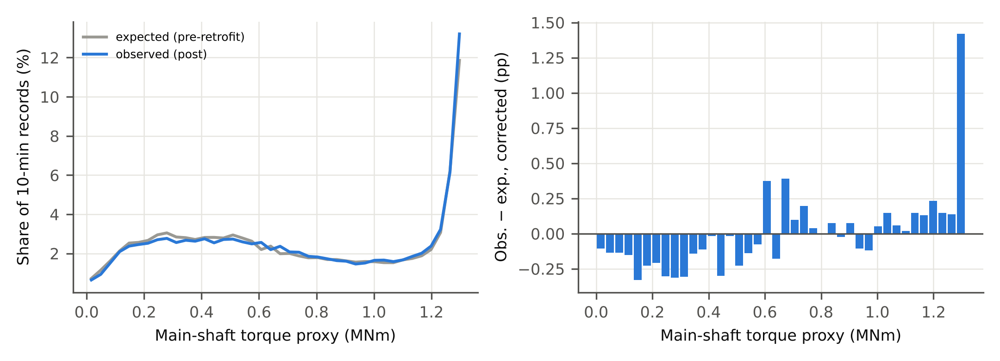
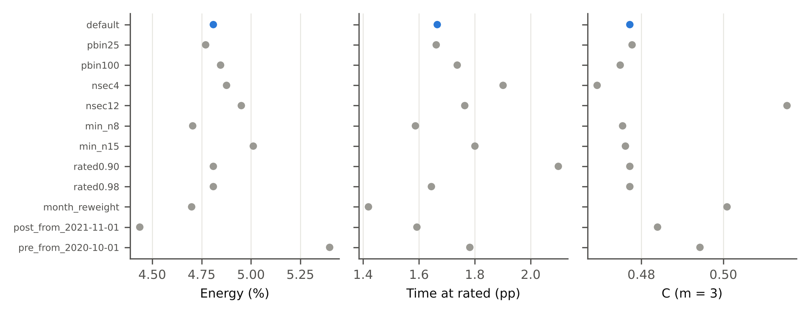
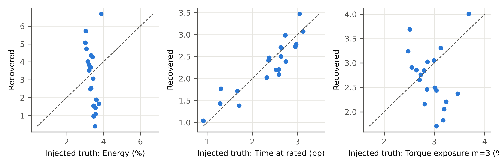
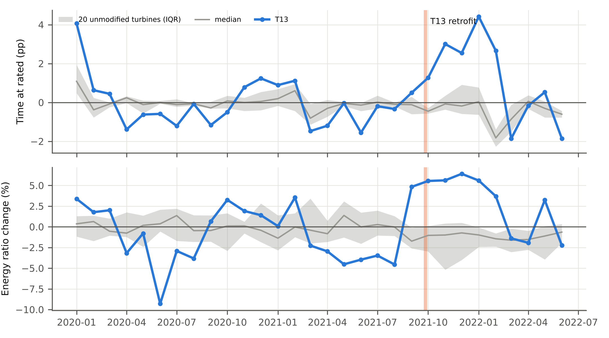
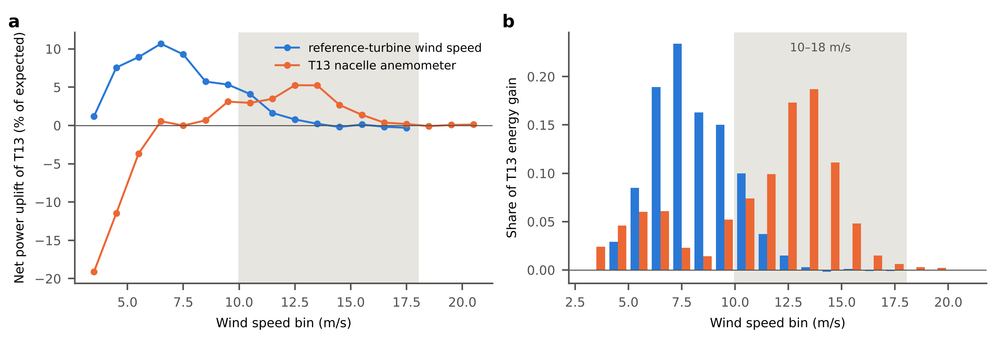

# Supplementary material

**What does a vortex-generator retrofit cost the drivetrain? Fleet evidence for the load price of an energy gain at an operating wind farm**

Yi Wang

## Table S1. Share of 10-minute records kept by the normal-operation filter (%), per turbine and year

| Turbine | 2020 | 2021 | 2022 | 2023 |
|---|---|---|---|---|
| T01 | 84.0 | 78.1 | 72.7 | 70.5 |
| T02 | 80.5 | 76.8 | 66.4 | 68.4 |
| T03 | 84.9 | 77.8 | 71.5 | 72.9 |
| T04 | 84.7 | 78.0 | 74.3 | 72.4 |
| T05 | 83.7 | 79.6 | 70.5 | 68.6 |
| T06 | 74.7 | 43.9 | 44.6 | 66.4 |
| T07 | 85.7 | 80.3 | 74.3 | 74.4 |
| T08 | 83.9 | 78.2 | 74.5 | 70.8 |
| T09 | 83.0 | 79.4 | 73.6 | 72.8 |
| T10 | 80.0 | 74.1 | 71.3 | 66.2 |
| T11 | 84.3 | 78.2 | 78.9 | 67.7 |
| T12 | 86.2 | 80.7 | 75.9 | 74.3 |
| T13 | 86.4 | 80.7 | 78.3 | 74.9 |
| T14 | 85.3 | 80.5 | 77.5 | 76.5 |
| T15 | 78.6 | 74.5 | 57.9 | 64.2 |
| T16 | 18.4 | 22.2 | 12.9 | 25.2 |
| T17 | 34.2 | 52.8 | 47.1 | 47.5 |
| T18 | 75.2 | 65.9 | 59.5 | 63.7 |
| T19 | 80.8 | 74.8 | 68.8 | 65.0 |
| T20 | 83.7 | 75.8 | 71.2 | 69.5 |
| T21 | 85.2 | 78.9 | 74.9 | 71.7 |

Kept = shutdown duration zero, P > 0, power set-point ≥ 2290 kW and main-shaft speed > 0.3 rad/s. All turbines: 77.3% (2020), 71.9% (2021), 66.6% (2022), 66.9% (2023).

## Supplementary figures

**Fig. S1.** T13 torque spectrum after the retrofit, observed versus expected from pre-retrofit cells (a), and the drift-corrected difference (b).

**Fig. S2.** Sensitivity of the drift-corrected T13 effects to one-at-a-time changes of the specification.

**Fig. S3.** Known-truth check: +4% power (capped) injected into each unmodified turbine; recovered versus injected values. The median is recovered without bias; the spread across turbines reflects each turbine's own null drift.

**Fig. S4.** Monthly effects relative to the pre-retrofit cells for T13 (blue) and the unmodified turbines (median and interquartile range). Pre-retrofit months are in-sample and show T13's own seasonal deviation from the fleet.

**Fig. S5.** T13's drift-corrected effect by 1 m/s wind-speed bin, binned on the mean nacelle wind speed of the reference turbines (blue) and on T13's own nacelle anemometer (orange). (a) Net power uplift relative to expected power; (b) share of T13's total net energy gain. Bins holding less than 0.5% of records are omitted. Shaded: 10–18 m/s, where [20] locates most of the gain.

